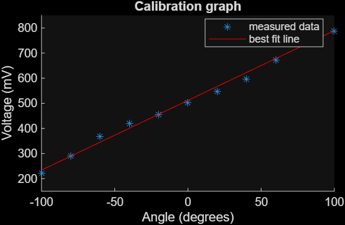
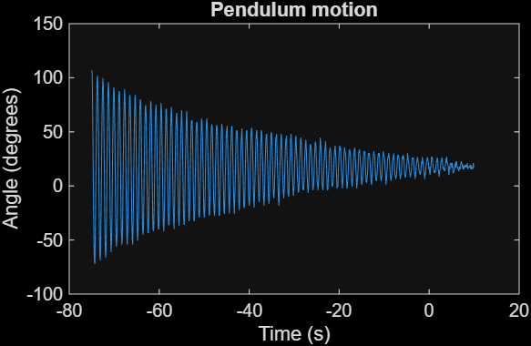

# Simple Pendulum: Angle Sensing with a Potentiometer

ISIM (Introduction to Simulation, Instruments & Measurement) lab. I turned a potentiometer into an angle sensor, calibrated it, and used it to record a pendulum swinging and coming to rest.

## How it works
The pendulum is attached to the shaft of a potentiometer wired as a voltage divider (1 V DC input). As the pendulum swings, the output voltage changes with angle, and an oscilloscope records it over time. A calibration curve converts voltage to angle.

## Calibration
I measured voltage at known angles from -100° to 100° (about every 20°) and fit a line:

**V = 2.78 mV/° · θ + 512 mV**

The relationship is approximately linear, as expected, because the potentiometer's resistance changes in proportion to the shaft angle. The highest-angle points curve slightly away from the line.

## Results
The pendulum's angle decays over time as friction removes energy, settling near 0°.

## Files
- `simple_pendulum.m`: MATLAB script for the calibration fit and angle vs. time plot
- `actualpendulumrun.csv`: oscilloscope data from the pendulum run

## How to run
Put `simple_pendulum.m` and `actualpendulumrun.csv` in the same folder, open the script in MATLAB, and run it. Adjust `tStart` and `tEnd` in the script if you need to crop the plot to the swing.
