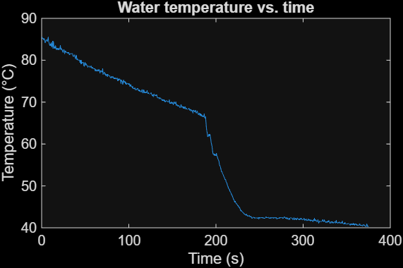

# Thermistor Thermometer: Tracking Water as It Cools

ISIM (Introduction to Simulation, Instruments & Measurement) lab. I built a thermometer from a thermistor and a voltage divider, then used it to compare how fast hot water cools on its own versus after adding ice water.

## How it works
A thermistor is a resistor whose resistance drops as temperature rises. I placed it in a voltage divider (5 V input, 10 kΩ fixed resistor) so the changing resistance becomes a changing voltage that an oscilloscope can record. The script then converts voltage to resistance to temperature.

The thermistor's transfer function is:

**R = R₀ · e^(3528 · (1/T − 1/298))**, with R₀ = 10 kΩ at 25 °C

## Analysis steps
1. **Voltage to resistance.** With the thermistor on the ground side of the divider, `Rt = R·Vout / (Vin − Vout)`.
2. **Resistance to temperature.** Invert the transfer function: `T = 3528·298 / (3528 + 298·ln(Rt/R₀))`.
3. **Plot** temperature vs. time.
4. **Compare** the temperature drop over the first 3 minutes of boiled water alone to the first 3 minutes after adding 20 mL of ice water.

## Design choice
The fixed resistor sets how much the output voltage changes across the temperature range. A divider is most sensitive when the fixed resistor is close to the thermistor's own resistance. The thermistor goes from about 12 kΩ at room temperature to about 1 kΩ near boiling, so I used 10 kΩ, which gives a usable voltage swing across the range. A much larger resistor would squeeze the signal into a narrow voltage window, and a much smaller one would barely respond at the cold end.

## Results

The water cooled gradually on its own, then dropped sharply when the ice water was added before leveling off near 40 °C.

- Drop in the first 3 minutes, water alone: about **[__] °C**
- Drop in the first 3 minutes after adding ice water: about **[__] °C**

## Files
- `thermometer.m`: MATLAB script that converts the data, plots temperature vs. time, and computes the two temperature drops
- `tempISIMlab2.csv`: oscilloscope data from the experiment
- `temperature_plot.png`: temperature vs. time plot

## How to run
Put `thermometer.m` and `tempISIMlab2.csv` in the same folder, open the script in MATLAB, and run it. The script prints both temperature drops in the command window. If the plot is cropped wrong, adjust the `xlim` lines, the `+350` time shift, and `tIce` (the time the ice water was added).
