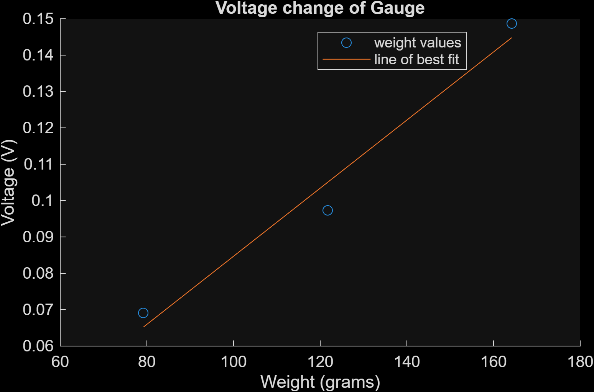

# Strain Gauge Scale: Weighing with a Bending Beam

ISIM (Introduction to Simulation, Instruments & Measurement) lab. I built a scale from an aluminum beam and a strain gauge, then calibrated it with known masses so a voltage reading becomes a weight.

## How it works
When the beam bends, the strain gauge stretches and its resistance rises by a tiny amount. A Wheatstone bridge (two voltage dividers side by side) turns that into a small voltage. A potentiometer balances the bridge to zero, since real resistors aren't perfectly matched. An AD623 instrumentation amplifier, with its gain set by a 200 Ω resistor, boosts the bridge output enough to measure:

**Gamp = 1 + 100,000 / R_G = 1 + 100,000 / 200 = 501**

## Calibration
I recorded the output voltage for three washers of known mass (79.2 g, 121.7 g, and 164.2 g), averaged each recording, and fit a line to voltage vs. mass. The relationship is approximately linear, as expected: voltage tracks resistance, resistance tracks strain, and strain tracks mass.

## Results
- Sensitivity: about **[0.94] mV per gram**
- Fit error: all three calibration points fall within about **[7]%** of the best-fit line (this measures how well the line fits, not the scale's accuracy on an unknown mass)
- A 20 mV change at the output corresponds to about **[21] g** of added mass
- Dividing by the amplifier gain of 501, that is about 40 µV from the bridge, so the gauge's resistance changes by about **[4] mΩ** out of 120 Ω (roughly 3 parts in 100,000)

The sensitivity analysis uses the quarter-bridge approximation ΔV ≈ Vin · (ΔR/R) / 4, with a 5 V bridge supply.

## Files
- `strain_gauge.m`: MATLAB script that averages each recording, fits the calibration line, and computes the fit error and the 20 mV analysis
- `79.2only.csv`, `121.7two.csv`, `164.2three.csv`: oscilloscope data for each washer
- `calibration_plot.png`: calibration graph

## How to run
Put `strain_gauge.m` and the three CSV files in the same folder, open the script in MATLAB, and run it. The command window prints the fit error for each point, the fractional resistance change, the resistance change in ohms, and the mass for a 20 mV change.
