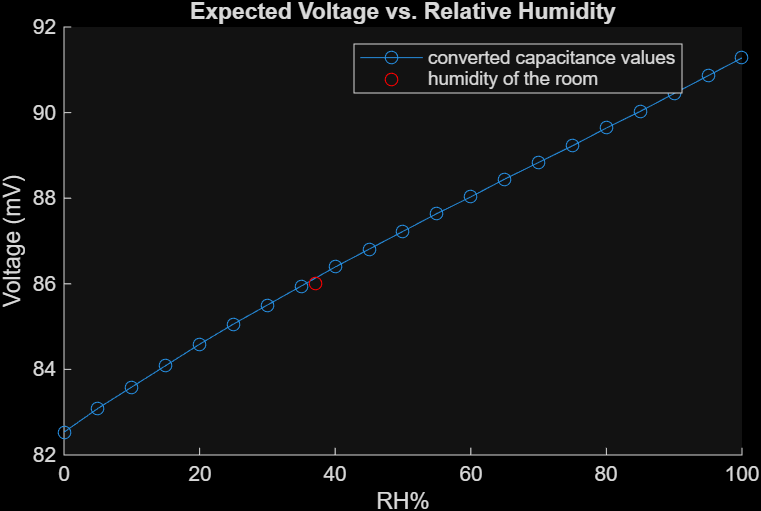

# Humidity Sensor: Measuring Relative Humidity with a Capacitor

ISIM (Introduction to Simulation, Instruments & Measurement) lab. A humidity sensor is a capacitor whose capacitance rises as water vapor soaks into its polymer. I built a circuit that turns that small capacitance change into a voltage, calibrated it, and used it to estimate the humidity in my room.

## How it works
The HS1101LF sensor's capacitance goes from about 162 pF at 0% RH to about 193 pF at 100% RH. I put it in a series RC circuit driven by a square wave. The capacitor charges and discharges on every edge, and the RMS output voltage depends on the capacitance: a larger capacitor gives a higher voltage. The chain is %RH → capacitance → voltage.

## Design choice
The signal has to fully decay within half of each square wave period, which takes about 5 time constants (5RC). With a **50 kΩ** resistor and the largest sensor capacitance (about 193 pF), 5RC is about 48 µs, which fits inside half a period of a **[10 kHz]** square wave.

## Calibration
Before using the sensor, I stood in for it with capacitors of known value (100, 120, 180, 200, and 220 pF) and recorded the RMS output voltage for each. The fit is approximately linear:

**V = 0.278 mV/pF · C + 37.7 mV** (R² ≈ 0.97)

## Results
Using the calibration line, I converted the datasheet's capacitance-vs-humidity table into the voltage the circuit should produce at each %RH. The curve runs from about 82 mV at 0% RH to about 91 mV at 100% RH.

With the sensor in my room, the RMS output was **[86] mV**, or about **[37]% RH**, which is a reasonable indoor value.

The circuit's sensitivity is only about 0.09 mV per %RH, so a 1 mV error in the voltage reading shifts the humidity estimate by about 11 percentage points.

## Files
- `humidity.m`: MATLAB script that fits the calibration, builds the expected voltage vs. %RH curve, and converts a measured voltage to %RH
- `humidity_calibration_plot.png`: calibration graph
- `voltage_vs_humidity.png`: expected voltage vs. relative humidity, with the measured point

The measured voltages are typed directly into the script from the oscilloscope's RMS readings, so there are no data files.

## How to run
Open `humidity.m` in MATLAB and run it. The command window prints the calibration equation, the estimated %RH for the measured voltage, and the circuit's sensitivity. To try a different measurement, change `measured_V`.
