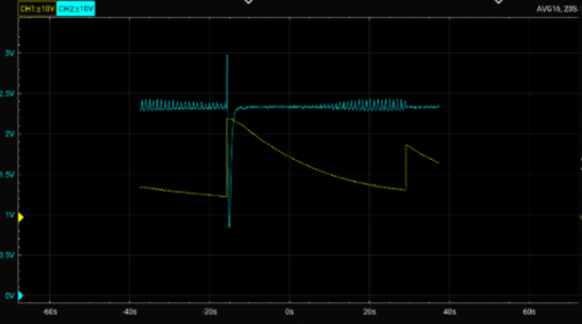
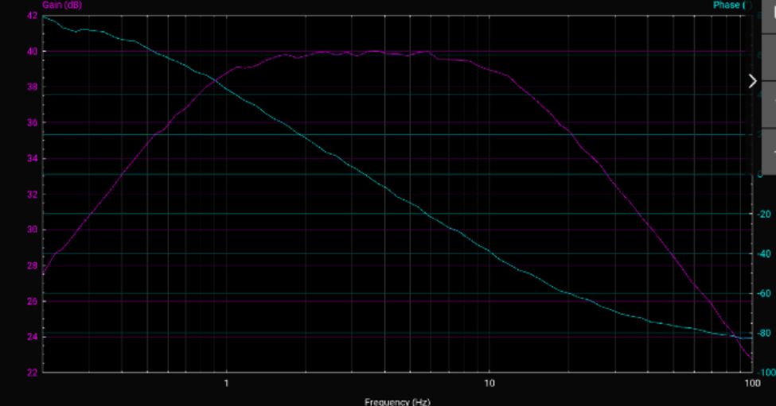

# Blood Pressure: Finding Mean Arterial Pressure from Cuff Oscillations

ISIM (Introduction to Simulation, Instruments & Measurement) lab. Automatic blood pressure cuffs estimate pressure from the tiny pulse oscillations riding on top of the cuff's slow deflation. I designed a filter circuit that pulls out those oscillations, and used it with a recorded dataset to estimate mean arterial pressure.

## How it works
The cuff pressure is a large, slowly decaying signal with a small pulse on top. The circuit separates the two:
1. **Two cascaded high-pass filters (0.8 Hz cutoff, 1 µF capacitors).** These remove the slow decay. Chaining two makes a second-order filter with a steeper roll-off, which was needed because the decay and the pulse are close in frequency.
2. **Low-pass filter (2 Hz cutoff).** This removes higher-frequency noise.
3. **Non-inverting amplifier (gain of 21).** This scales the pulse up to a readable level.

The circuit is referenced to 2.5 V, so the signal can swing above and below the baseline without going negative.

## Analysis steps
1. **Voltage to pressure.** The MPX5050DP sensor's transfer function is `Vout = Vs · (0.018·P + 0.04)` with P in kPa and Vs = 5 V, so `P = (Vout/Vs − 0.04) / 0.018`. Multiplying by 760/101.325 converts kPa to mmHg.
2. **Crop to the real run.** The start of the file has leftover data from an earlier run, so the script keeps only the data from about −15 s onward.
3. **Find the pulse amplitude peak.** The script measures the pulse size in a sliding window, smooths it, and finds where it is largest.
4. **Read the cuff pressure at that moment.** That pressure is taken as the mean arterial pressure.

## Results

The pulse amplitude peaks at about **24 s**, when the cuff pressure was about **71 mmHg**. That is the estimated mean arterial pressure for this recorded dataset. The peak is broad, so anywhere from roughly 60 to 85 mmHg is a defensible reading.

Bode plot of the filter circuit, with high-pass cutoffs near 0.8 Hz, a low-pass cutoff near 2 Hz, and an overall gain of about 21.

## Files
- `blood_pressure.m`: MATLAB script that converts the sensor voltage to pressure, finds the pulse amplitude peak, and plots the raw pressure above the filtered signal
- `lab6.csv`: recorded oscilloscope data (`ch1` = pressure sensor output, `ch2` = filtered circuit output)
- `pressure_plot.png`: raw pressure and filtered signal
- `bode_plot.png`: Bode plot of the filter circuit

## How to run
Put `blood_pressure.m` and `lab6.csv` in the same folder, open the script in MATLAB, and run it. The command window prints the time and cuff pressure at the pulse amplitude peak. If the plot is cropped wrong, adjust `tStart` near the top of the script.

## Note
This is a recorded course dataset, not a live measurement of a person, and the only quantity interpreted is mean arterial pressure.
